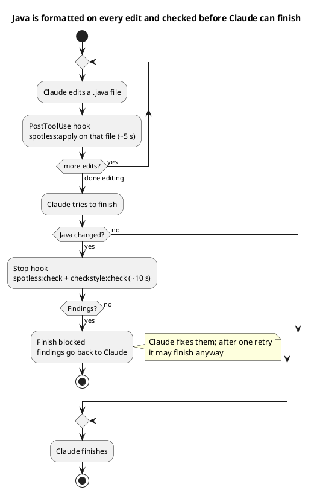

# IDE & Claude Code setup plan — build-standards

As of 2026-10-25. The how-to itself lives in [IDE-SETUP.md](../../IDE-SETUP.md).

## Goal and scope

IntelliJ and Claude Code should produce Java that already passes the shared config, so CI rarely has to reject it.
`./mvnw spotless:apply` and `./mvnw checkstyle:check` stay the source of truth; editor settings and agent hooks only get
close to their output earlier.

- **In scope:** formatter and Checkstyle setup in IntelliJ, `CLAUDE.md` guidance and hooks for Claude Code, the
  `.editorconfig` line-length mismatch.
- **Out of scope:** other IDEs, CI pipeline changes, the pre-existing `make maven-ci` failure (tracked separately).

## Changes in the repo

All shipped together in one commit; see the CHANGELOG entry.

| File | Change |
| --- | --- |
| `.editorconfig` | `max_line_length` 140 → 160, matching the formatter's `lineSplit` and Prettier's `printWidth` |
| `IDE-SETUP.md` (new) | IntelliJ and Claude Code setup guide; linked from `README.md` and `USAGE.md` |
| `templates/claude-code/CLAUDE.java-style.md` (new) | Java style section to append to a consuming project's `CLAUDE.md` |
| `templates/claude-code/.claude/settings.json` (new) | Registers the PostToolUse and Stop hooks |
| `templates/claude-code/.claude/hooks/spotless-file.sh` (new) | Formats the edited `.java` file |
| `templates/claude-code/.claude/hooks/checkstyle-gate.sh` (new) | Blocks finishing while changed Java fails `spotless:check` or `checkstyle:check` |
| `README.md`, `USAGE.md`, `CLAUDE.md`, `CHANGELOG.md` | Point to the new guide and template |

The hooks are a template for projects that inherit `repo-parent`. They are not enabled in this repository, whose root
reactor declares neither Spotless nor Checkstyle.

## IntelliJ setup checklist

Format with the real Eclipse engine and lint with the real Checkstyle config; the remaining settings stop IntelliJ from
undoing them. Config files: `repo-code-quality-configs/src/main/resources/`, or inside
`repo-code-quality-configs-<version>.jar` in `~/.m2`.

- [ ] Install **Adapter for Eclipse Code Formatter**; enable it with `repo_java_style.xml` and its profile (matches
  Spotless when the plugin uses Eclipse 4.41)
- [ ] Optional: **Spotless Applier** plugin, to run the project's real `spotless:apply` from the IDE
- [ ] Install **CheckStyle-IDEA**; select Checkstyle 14.3.0 (or the nearest 14.x); add `checkstyle.xml`; set
  `checkstyle.suppressions.file` to `suppressions.xml`
- [ ] CheckStyle-IDEA → Third-Party Checks: add `repo-code-quality-configs-<version>.jar`, or the custom checks fail to
  load
- [ ] Code Style → Java → Imports: both "count to use import with '\*'" fields = 999
- [ ] Wrapping and Braces → Force braces = Always for `if`, `for`, `while`, `do-while`
- [ ] Inspection "Local variable or parameter can be 'final'": local variables only
- [ ] Optional: Arrangement = static fields, fields, constructors, methods; fields public → private
- [ ] Actions on Save: reformat + optimize imports (after the import counts above)

Not available in IntelliJ: the size-dependent blank lines and the parameter-wrap rule. CheckStyle-IDEA flags them; fix
by hand.

Fallback if the adapter's Eclipse version does not match: import `repo_java_style.xml` via Code Style → Java → ⚙ →
Import Scheme → Eclipse XML Profile. It is approximate; run Spotless before pushing.

## Claude Code setup

Three files make Claude Code follow the style: a `CLAUDE.md` section so it writes compliant code, a hook that formats
each Java file it edits, and a gate that keeps it from finishing while changed Java fails the checks.



Only the gate can block, and only on real findings: a missing `jq`, `pom.xml` or Maven, or a build error that isn't a
finding, lets Claude carry on.

Install in a project that inherits `repo-parent`:

```bash
cp -r templates/claude-code/.claude <project>/   # merge by hand if .claude/settings.json exists
cat templates/claude-code/CLAUDE.java-style.md >> <project>/CLAUDE.md
chmod +x <project>/.claude/hooks/*.sh
```

| Hook | Trigger | Does | Cost |
| --- | --- | --- | --- |
| `spotless-file.sh` | PostToolUse on Edit, MultiEdit, Write | `spotless:apply` limited to the edited `.java` file | ~5 s per Java edit |
| `checkstyle-gate.sh` | Stop | When `.java` files changed: `spotless:check` + `checkstyle:check`; on findings exits 2 and lists them | ~10 s when Java changed, 0 s otherwise |

Requirements: `jq`, and `./mvnw` or `mvn` at the project root. To make it cheaper, drop the PostToolUse hook and let the
gate catch unformatted files.

## Verification

Both hooks pass all seven cases, run against `samples/formatting-sample` as a stand-in consuming project, with Claude
Code's stdin JSON simulated. The IntelliJ steps were not tested: IntelliJ was not available when the hooks were verified.

| Case | Expected | Result |
| --- | --- | --- |
| PostToolUse, non-Java file | No-op | Exit 0, 0 s |
| PostToolUse, unformatted `MessyOrderService.java` | Formats only that file | Exit 0, ~5 s; file then passes `spotless:check` |
| PostToolUse, Java that no longer parses | Left alone | Exit 0; the compiler reports it, Spotless can't |
| Stop, no Java changed | Skip Maven | Exit 0, 0 s |
| Stop, unformatted files + Checkstyle violations | Block and list both | Exit 2, ~10 s, both lists sent back |
| Stop, already retried once | Let Claude finish | Exit 0 |
| Stop, Java changed, all clean | Pass | Exit 0, ~10 s |

Two bugs found and fixed during testing: the gate's regex missed Spotless's file list (it prints five spaces, not four),
and a test-harness reset restored the old script. `.editorconfig` 160 was checked against Prettier's `printWidth` (also
160), so JS/TS formatting is unaffected.

## Open items

- [ ] Apply the IntelliJ checklist on a real machine and confirm the Eclipse adapter's formatter version matches 4.41
  (else Spotless and IDE output differ slightly)
- [ ] Confirm CheckStyle-IDEA offers Checkstyle 14.3.0; if not, pick the nearest 14.x
- [ ] Copy `templates/claude-code/` into a first consuming project and watch one real Claude Code session
- [ ] Optional: add IntelliJ `ij_java_*` keys to `.editorconfig` (import counts, forced braces) so IntelliJ picks them
  up without manual setup; the key names need checking in IntelliJ first
- [ ] Fix `make maven-ci` (separate task: the root reactor can't resolve `spotless:` / `checkstyle:`)

Known limits: IntelliJ can't apply the size-dependent blank-line rule or the parameter-wrap rule (only CheckStyle-IDEA
flags them), and the hooks add ~5 s per Java edit and ~10 s at finish.
